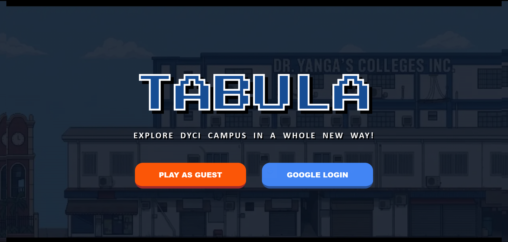

# Tabula

**Explore the DYCI campus in a whole new way.**

Tabula is a 2D pixel-art map of the Dr. Yanga's Colleges, Inc. campus (Bocaue, Bulacan) that you explore like a game.
Pick a character, walk the grounds, step up to a building to see its floors and rooms, talk to the people you meet,
and earn XP and achievements along the way. Visitors can play as a guest; students sign in with Google to keep their
progress.



## Features

- **Walk the campus**: a top-down pixel-art map with collision boundaries, keyboard controls on desktop and touch
  controls on phones.
- **Buildings, floors and rooms**: walk up to a building to see its description and the rooms on each floor.
- **Search and directions**: search for a building or room and get a path to it across the campus walkways.
- **NPCs and quests**: characters around the campus start short quests with cutscenes.
- **Mini-games**: Wire Repair and Memory Match, three levels each, tuned for landscape phones.
- **Progress**: XP, levels and achievements, saved for signed-in players.
- **Guest or Google sign-in**, with a first-visit character setup.
- **Admin console**:
  - a dashboard with statistics;
  - user and role management;
  - an activity log;
  - a building manager;
  - a visual map editor for placing buildings;
  - an approval queue for building edits.

## Tech stack

| Area | Technology |
|---|---|
| Game | JavaScript with the HTML5 canvas; sprites and a map built in Tiled |
| Back end | PHP with PDO |
| Database | MySQL |
| Sign-in | Google Identity Services |
| Art | Pixel-art building, character and NPC sprites (WebP and PNG) |

## Getting started

Requirements: PHP 8 and MySQL. XAMPP or a similar stack works.

1. Clone the repository into your web server's folder, for example `htdocs/Tabula-2DGameMap`.
2. Create a MySQL database. The app uses these tables: `users`, `player_progress`, `achievements`,
   `player_achievements`, `buildings`, `floors`, `rooms`, `npcs`, `npc_cooldowns`, `player_npc_talks`,
   `player_building_visits` and `activity_log`. Their schema is not included in this repository.
3. Copy `.env.example` to `.env` and fill in the database host, name, user and password.
4. To use Google sign-in, set your own OAuth client ID in `index.html` and `map/index.js`, and add your site's
   address to that client's authorized JavaScript origins.
5. Open `index.html` through the web server, for example `http://localhost/Tabula-2DGameMap/`.

Building positions, NPCs and progress live in the database. Add buildings through the admin console's map editor.

## Project structure

```
index.html          start screen (guest or Google sign-in)
setup.php           first-visit character setup
menu.php            main menu (signed in)    guest_menu.php   main menu (guest)
map/                the game: map.html, index.js, NPCs, mini-games, pathfinding, search
  data/             walkable boundaries and waypoints (JSON)
  img/              map, building, character and NPC sprites
admin/              admin console: dashboard, users, buildings, map editor, approvals
php/                API endpoints, sign-in, guards, progress and achievements
  config/           database connection (reads .env)
assets/             shared images and the sign-in script
```

## Credits

Made as a student project for Dr. Yanga's Colleges, Inc. Campus building names and likenesses belong to DYCI.
